# ASTRO CODE

**The social network that makes you look up from your screen.**

12 hoodies. 12 zodiac signs. Scan the sign on someone's hoodie and the creature comes alive in augmented reality, orbiting the person wearing it. You don't collect followers here — you collect the signs of people you actually **met**.

*Not followed. Met.*

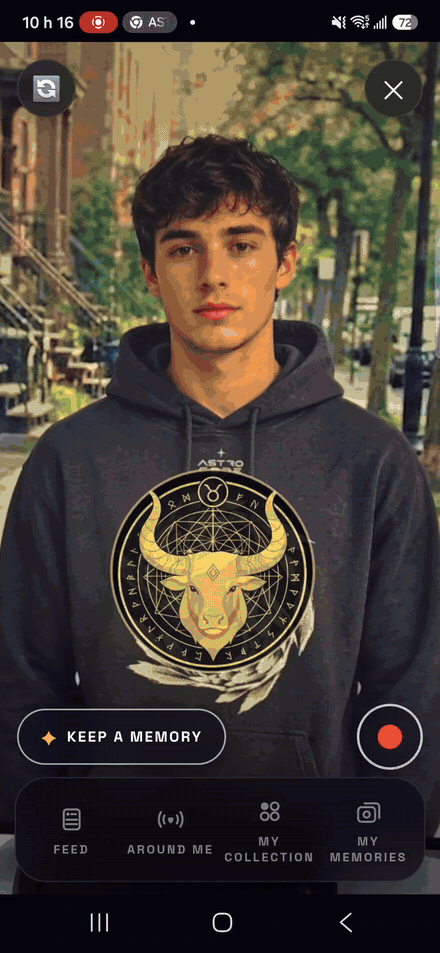

---

### ▶ Try it live — https://astro-code-5.netlify.app

### 🎬 Watch the 3-minute demo — {{YOUTUBE_URL}}

**No hoodie? No problem.**
1. Open the live app on your phone (**Android** — the scan does not work on iPhone yet; see *Honest scope*).
2. Link a hoodie with the demo code **`ASTRO-8842-PISCES`** (you become Pisces).
3. Point your camera at the target images in [`demo-targets/`](demo-targets/) — scan **Pisces** for the solo show, scan **Leo** for an encounter, hold both in frame for the **fusion**.

The scan works on a screen showing the target images.

---

## The idea

We barely talk to each other in real life anymore. Astro Code turns a hoodie into a reason to meet.

Every collection on every social app is a list of accounts. An Astro Code collection is a list of **encounters**: a sign only enters your collection when you stood in front of a real person, talked to them, and scanned their hoodie. Twelve signs, twelve real meetings — collect all 12 and you unlock your **Imprint**: your own words, written on your hoodie, shown to everyone who scans you.

## One encounter, in four beats

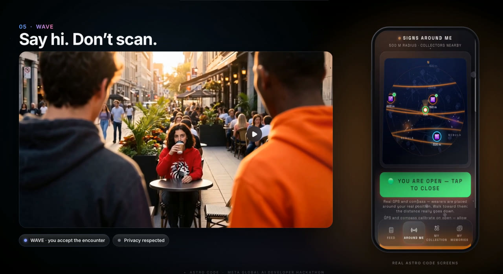

**Meet** — *Find Wearers Around Me* shows nearby collectors as signs and distances (anonymous hot zones by default — no profiles to scroll). A wearer with a **green dot is waving**: they have declared themselves open — *come say hi, come scan me.*

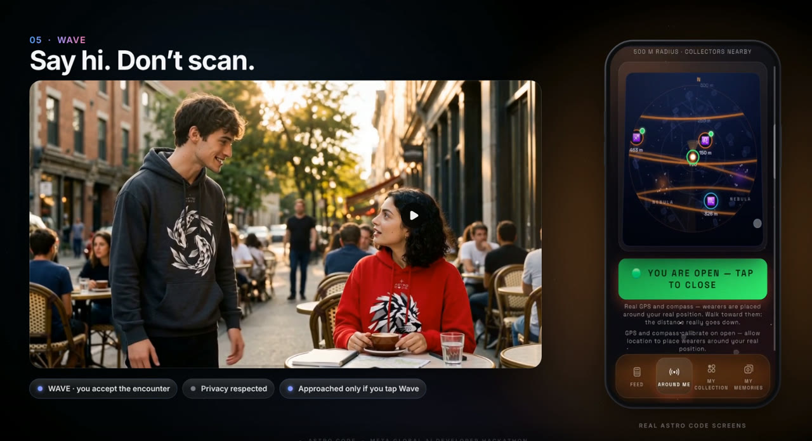

**Talk** — you talk first. Then you scan. When you scan someone else's sign, **Muse Spark** writes an icebreaker between your two signs, right inside the show.

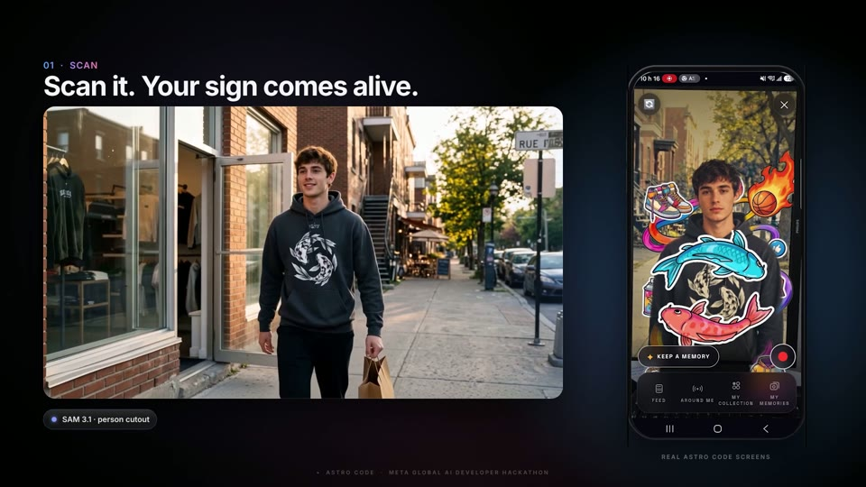

**Scan** — the sign comes alive around the wearer: **MediaPipe Selfie Segmentation** cuts them out of the camera feed live, in the browser, so the creature swims *around* their body, their sign speaks in a soft human voice, and **Muse Wonder** writes their horoscope live.

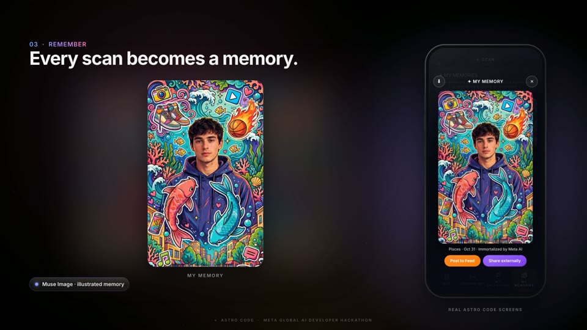

**Keep** — tap *Keep a Memory* and **Muse Image** turns the moment into an illustration — your real face and hands, everything else painted, the creature alive in orbit. Post it to the Feed, or keep it in *My Memories*.

Scan two signs in the same frame and something neither sign owns appears: the **Duo Fusion**.

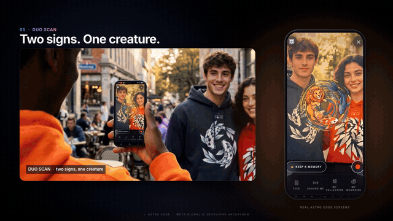

*Duo Fusion — Pisces meets Leo, and a third creature appears.*

## Built with Meta AI

Five Meta models, each doing the one job it is best at — chained inside a single human moment:

| Model | What it does in Astro Code |
|---|---|
| **SAM 3.1** | Segments the wearer on keyframes inside *Try a Hoodie Live* (through the server proxy) to locate the torso zone the live restyle paints on |
| **Muse Wonder** | Writes the personalized horoscope of every sign you scan |
| **Muse Spark** | Writes the encounter icebreaker between two signs — and moderates every Imprint before it is published |
| **Muse Image** | Turns a scan into a Memory: a flat-color illustration where the sign creature stays alive |
| **Muse Voice Transcribe** | Hears you in *Try a Hoodie Live* — you speak, Spark understands, the hoodie changes |

All Meta calls go through a server-side proxy (Netlify Function) with an allowlist, per-IP rate limits and response caps — API keys never reach the client.

## What's in the app

- **Scan** — MindAR image tracking, a 2D-canvas spectacle painted in real time around the segmented wearer
- **The Encounter rule** — scanning a sign that isn't yours triggers the Spark icebreaker instead of the horoscope; a solo scan of your own sign keeps Wonder's horoscope
- **Duo Fusion** — Pisces + Leo tracked at the same time (half-second decision window) merge into a creature that didn't exist before; fusion never triggers from a solo scan
- **My Collection** — the badge flies into your collection, which is the map of people you met (2/12 in the demo story)
- **Write your Imprint** — unlocked at 12/12, auto-moderated by Spark, changeable once per quarter
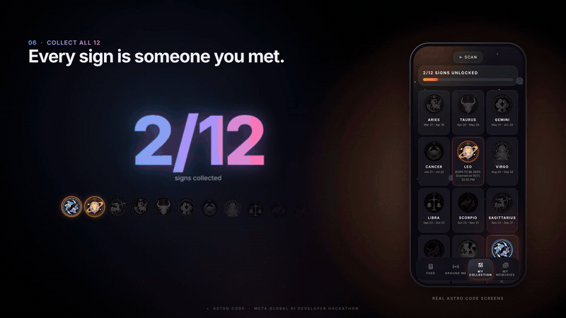

*My Collection — the map of your encounters (2/12 in the demo story).*

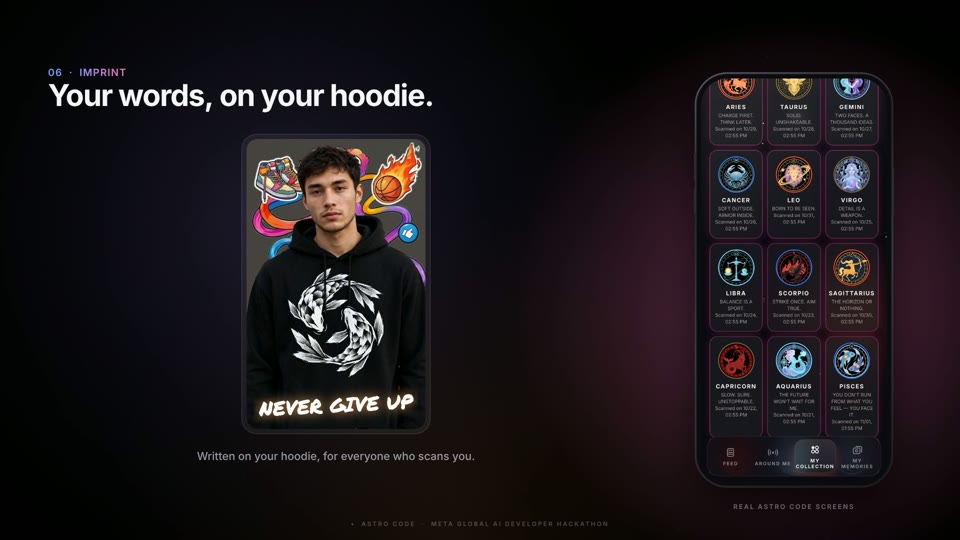

*The Imprint — unlocked at 12/12, moderated by Muse Spark.*

- **My Memories + Feed** — illustrated souvenirs become posts; the sign badge is the avatar
- **Find Wearers Around Me** — radar with three privacy levels; anonymous hot zone by default
- **The Wave** — the consent signal of the network: tap *Wave* and you are visibly open to encounters for 30 minutes; a nearby open wearer waves back. Nobody is ever shown open by default — the wave is always a deliberate choice, written as a rule in the code (`LE WAVE` in `map.js`)
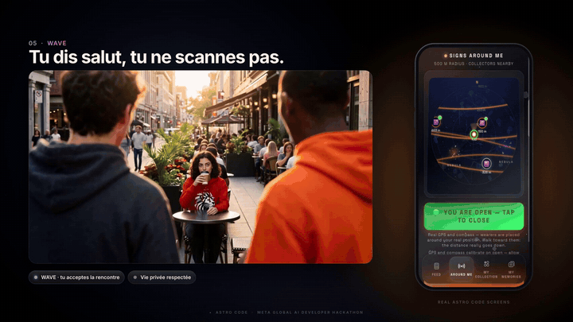

*The Wave, on a real app screen: green means open — and nobody is ever shown open by default.*

- **Today's horoscope** — every collected sign gets a fresh Muse Wonder horoscope each morning, on its card in *My Collection*
- **Try a Hoodie Live** — no hoodie yet? Live video try-on (Decart Lucy) restyles you in real time, piloted by voice through Meta's models; the hoodies themselves are drawn as original SVG artwork and fabricated with Muse Image
- **My Constellation** — the signs you collected, floating; every star is someone you met

**Accounts without email or password** — phone number + a pseudo. The QR on the label opens the app; a unique scratch code on the wash label links **one hoodie to one owner**. *One code. One hoodie. One owner.* In this demo build, that link is stored locally on the phone — the server check that burns the code on first use ships with the multi-user backend (see *Honest scope*).

## Honest scope

- **iPhone: the scan does not work yet** — on iOS, the background behind the scan renders black. The full demo experience today runs on **Android (Chrome)**. Being fixed.
- **2 signs are fully playable end-to-end today** (Pisces and Leo) — scan, voice, horoscope, icebreaker, Memory, fusion, Constellation. The other 10 signs are designed; depth first, because depth is what proves the 12 are a production pipeline, not a rewrite.
- NFC tap-to-verify is designed and announced in the app as *coming soon* — it is deliberately **not** on the demo's critical path.
- **Hoodie linking is local in this build** — the passport lives on the phone; the server that burns a scratch code on first use is the post-hackathon backend, on the same roadmap as NFC.
- The smart-glasses finale of the demo film is labeled **CONCEPT** — it is the product's destination, not a claim about today.

## Tech

Vanilla JavaScript (no framework), MindAR + three.js for tracking, MediaPipe Selfie Segmentation in the browser, a custom 2D canvas engine for the spectacle, Netlify (static hosting + serverless proxy + token functions), Decart Lucy for live try-on. Everything runs on a phone browser — no install.

Deeper technical notes, in French, from the build itself: [`docs/TECHNICAL-README.md`](docs/TECHNICAL-README.md).

## Run it locally

```sh
# any static server works for the front-end
npx serve .
# Meta AI features need the Netlify functions + env vars:
# META_MODEL_API_KEY, DECART_API_KEY (see netlify/functions/)
```

## The film, in frames

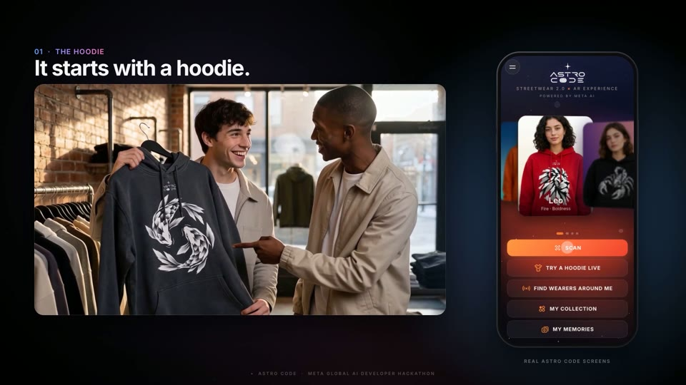

*It starts with a hoodie — the shop, the sign, the choice.*

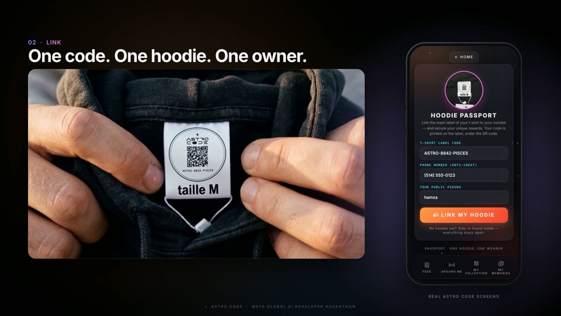

*One code. One hoodie. One owner — the scratch code on the wash label.*

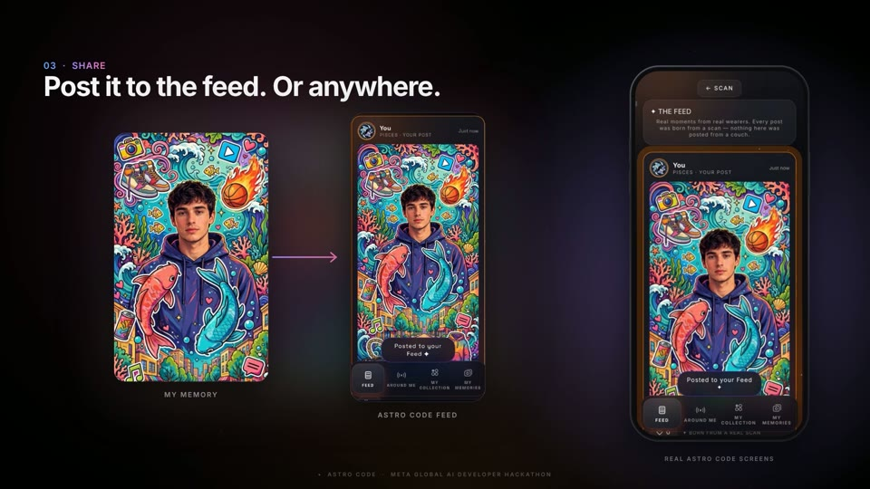

*Post it to the Feed — every post is born from a real scan, never from a couch.*

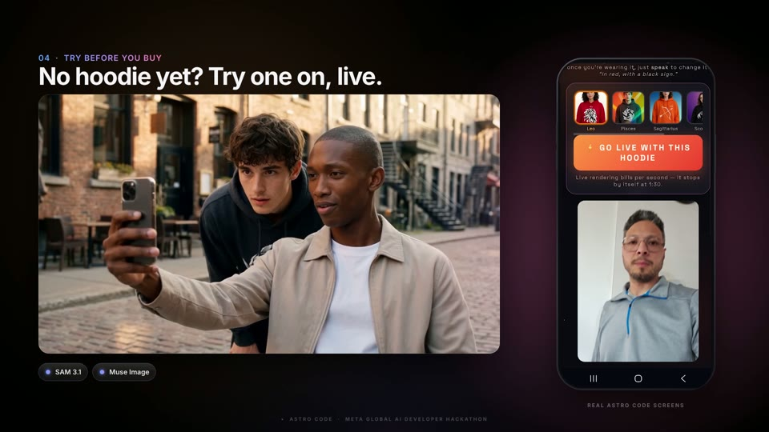

*Try a Hoodie Live — speak, and the hoodie changes.*

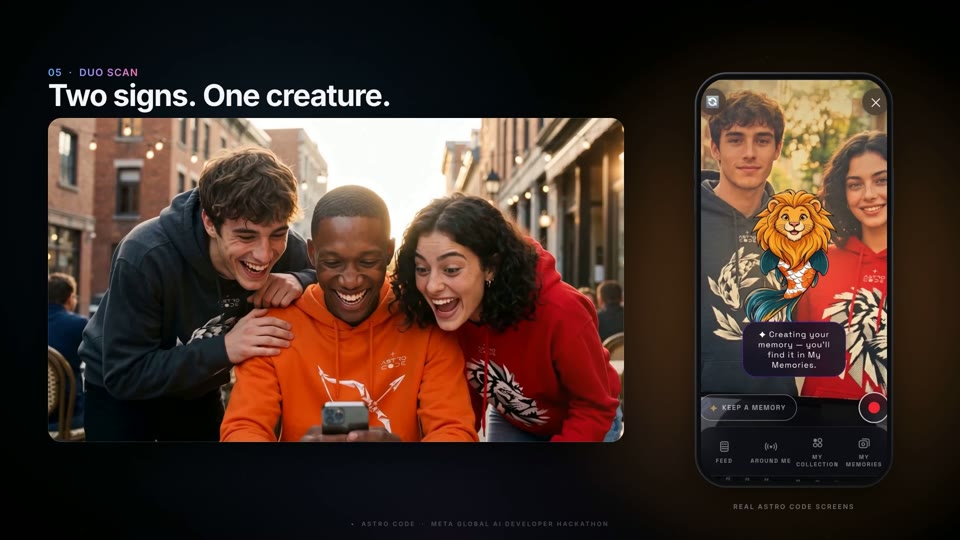

*Two signs. One creature. One moment that belongs to neither sign alone.*

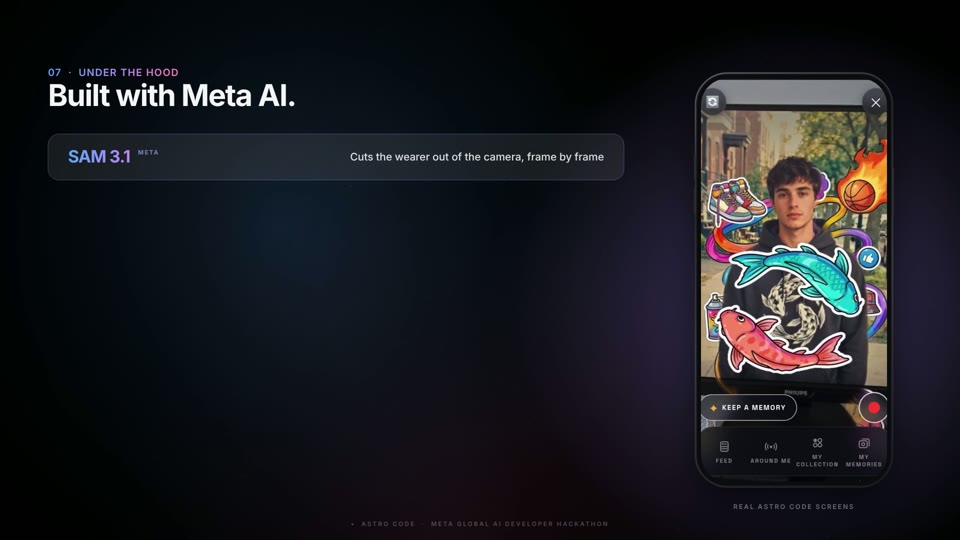

*Built with Meta AI — five models, five real jobs.*

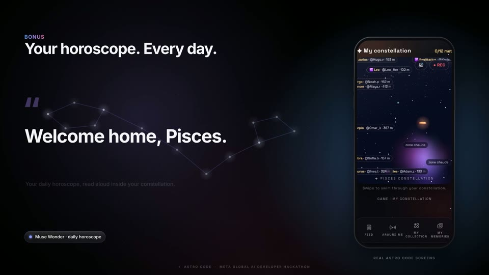

*Your horoscope. Every day. Welcome home — this is your constellation.*

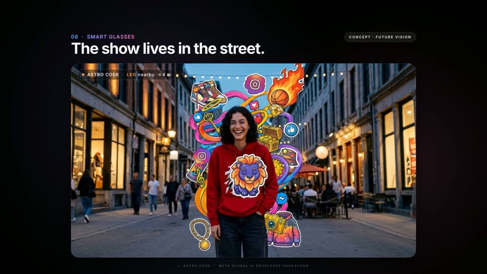

*The show lives in the street.*

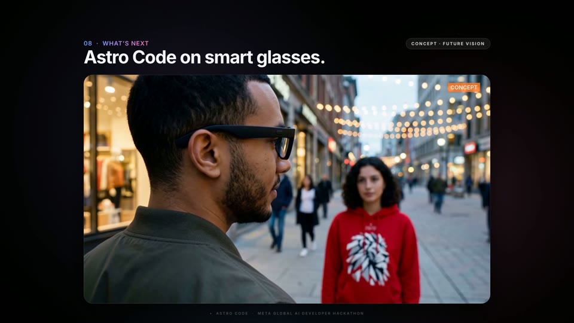

*Astro Code on smart glasses — CONCEPT · FUTURE VISION: the destination.*

## The project

Astro Code is a real phygital streetwear brand by **Hamza Nezzar** (Montreal) — designed and built solo for the **Meta Global AI Developer Hackathon** (Oct 26 – Nov 4, 2026), Indie Developer track, theme *Build for Your World*.

The demo film combines real app screen recordings with AI-generated street scenes. Physical hoodies are not yet produced: the scans were run on screens with the target images. You talk first. Then you scan.

**Astro Code. Not followed. Met.**

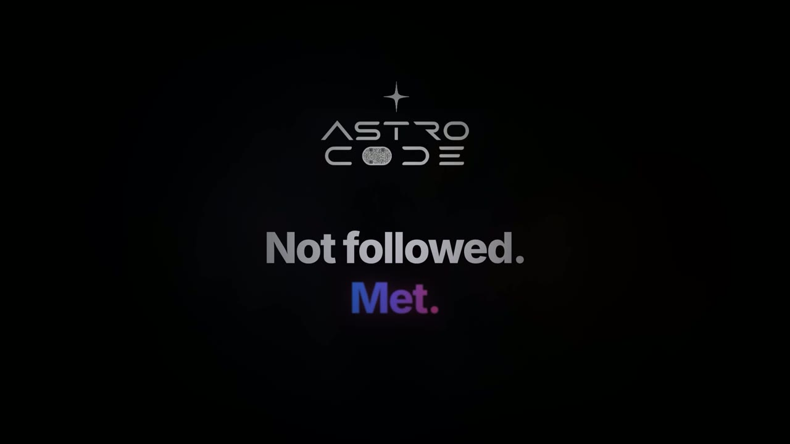
